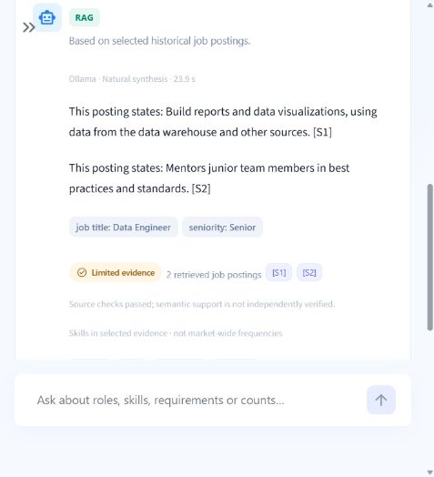
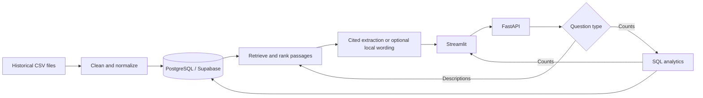

# Data Job Market Intelligence

Explore 12,217 historical job advertisements through SQL statistics, job search
and answers that show their source passages.

Application code is in [`data-job-market-intelligence/`](data-job-market-intelligence/); the CI workflow is in this Git root.

## The problem

Reading thousands of adverts makes it hard to keep track of recurring skills or
responsibilities. This application lets someone ask a numerical question, inspect
individual jobs, or read a cited answer about a role.

**The collection covers January 12–17, 2024. It is a historical snapshot, not a live vacancy feed.**

## What you can do

- Compare skill counts, roles, seniority and recorded locations.
- Filter and search job cards, then follow their original posting links.
- Ask numerical questions answered by database queries.
- Ask descriptive questions answered with selected passages and citations.
- Try optional local Qwen generation; use **Extractive fast** for the recommended default.

## A real example

“What percentage of jobs mention Python?” → **5,121 / 12,217 = 41.92%**.
A SQL query counts each job once per detected skill. Descriptive answers use a
separate retrieval path and abstain when selected evidence is insufficient.



*Actual native-interface check, 30 October 2026, using optional Ollama.
This screenshot is not evidence of public deployment or of Docker generation.*

## Architecture



## Verified results

| Result | Evidence |
|---|---|
| 12,217 jobs; 30,955 V2 chunks/embeddings | Recorded PostgreSQL audits; BGE-small-en-v1.5, 384 dimensions. |
| 196 tests, including 3 PostgreSQL tests | Fresh local run, 31 October 2026; Ruff passed. |
| Docker API/frontend and SQL/extractive RAG working | Owner-reported manual tests with external Supabase; configuration independently checked. |
| Qwen: four accepted responses in four attempts | Small CPU benchmark, 30 October; two responses dropped a claim. |

[Evidence, dates and limits](data-job-market-intelligence/docs/PROJECT_VALIDATION_SUMMARY.md). Hosted GitHub
Actions success is **unverified**. The 31 October agent session could validate
Compose configuration but could not reach the Docker engine or mapped ports.

## Technology

Python for preparation and logic; PostgreSQL/pgvector for records and semantic
search; FastEmbed/BGE for embeddings; FastAPI for requests; Streamlit/Plotly for
the interface; pytest/Ruff for checks; Docker Compose for local containers.
Optional Ollama runs Qwen 2.5 1.5B locally. No language model is trained here.

## Quick start: existing database, Windows

From the **Git repository root**:

```powershell
Set-Location .\data-job-market-intelligence
python -m venv .venv
.\.venv\Scripts\python.exe -m pip install -r requirements-dev.txt
if (-not (Test-Path -LiteralPath .env)) { Copy-Item .env.example .env }
```

Privately configure your existing populated PostgreSQL/Supabase database and
complete V2 index in `.env`. Data and credentials are **not included** in a clone.
Then, in two terminals from the application folder:

```powershell
.\.venv\Scripts\python.exe -m uvicorn api.main:app --host 127.0.0.1 --port 8000
# Second terminal:
.\.venv\Scripts\python.exe -m streamlit run app/Home.py --server.port 8501
```

Open [UI](http://127.0.0.1:8501) or [API docs](http://127.0.0.1:8000/docs).
[Complete setup and prerequisites](data-job-market-intelligence/docs/SETUP_AND_RUN.md). This safe start does
not load data, run bootstrap or rebuild embeddings.

## Docker: existing external Supabase

The owner's `compose.supabase.yml` runs API and frontend only. Open the API on
[8002](http://localhost:8002/health) and the UI on [8502](http://localhost:8502).
Inside Compose, Streamlit calls `http://api:8000`.
[Exact build/start commands](data-job-market-intelligence/docs/SETUP_AND_RUN.md#docker-with-existing-external-supabase).
The original `docker-compose.yml` is a separate database/setup workflow.

## Tests and CI

From the application folder:

```powershell
.\.venv\Scripts\python.exe -m evaluation.safe_checks --output evaluation/results/checks.json
```

This selects offline tests. Add `--live` deliberately for the three read-only
PostgreSQL tests. The workflow is in the **parent Git root**, at
`.github/workflows/ci.yml`. It contains checks; no hosted pass or deployment is claimed.

## Limits and publication

The corpus is historical and uneven, with missing fields and unclassified titles.
Literal quotations prove traceability, not every semantic interpretation.
Generation is constrained; fallback and abstention remain visible. Data/model
caches are excluded, and redistribution rights are not established by this review.

A previously exposed database credential still needs **manual rotation before
public publication**. See the [readiness report](data-job-market-intelligence/docs/github-readiness-report.md).
No public deployment or successful hosted CI run is claimed.

## Read the project story

[The complete story, from the first advert to the tested application](data-job-market-intelligence/docs/PROJECT_STORYTELLING_END_TO_END.md)
explains each step for nontechnical readers, with links to the implementation and evidence.
