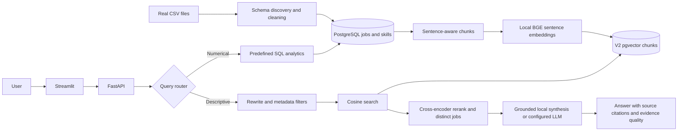

# Data Job Market Intelligence

**12,000+ job postings. One question: what does the data job market actually ask for?**

A portfolio application that turns job-posting CSVs into PostgreSQL analytics, a designed Streamlit explorer, and answers supported by retrieved job text. V2 adds local neural retrieval and reranking while retaining the V1 index for rollback.

## Measured V2 validation — 11 October 2026

V2 is active with 12,217 jobs, 30,955 chunks and 30,955 pgvector embeddings. Every stored vector matches its saved computed checkpoint. All 61 tests pass, including three PostgreSQL tests; Ruff, the six requested API routes, ten real questions and manual Streamlit checks pass. The [detailed French report](docs/rapport-detaille-implementation-et-validation.md) includes answers, filters, sources, latencies, the measured V1/V2 comparison and all 20 Definition-of-Done criteria.

Docker is unavailable on this machine. Compose passes YAML parsing, the official Compose JSON schema and 16 static checks; `docker compose config`, image builds and `docker compose up --build` were not executed locally. Hosted CI and optional OpenAI/Ollama generation were not validated.

## Project overview, problem, and solution

Unstructured postings make it difficult to compare roles and skills or trace the basis for career advice. This application separates exact, reproducible statistics from descriptive evidence. FastAPI owns all business logic; Streamlit calls its HTTP endpoints.

The supplied local dataset contains 12,217 postings collected January 12–17, 2024. This is a **historical snapshot, not today's live job market**. The application retains all source roles, including an Other / Unclassified category. It does not assume every posting belongs to a canonical Data/AI role.

## Architecture



## Features

- Schema-adaptive CSV joins, deterministic cleaning, skill extraction, and JSON data-quality reports.
- Transactional PostgreSQL loading with separate application schema, normalized skill rows, and pgvector chunk storage.
- Filtered counts, top skills, role/seniority/geography/employer/workplace distributions, and comparable salary summaries when present.
- Market overview charts, a paginated job explorer, and a chat interface backed by the API.
- Local BGE-small sentence embeddings and a MiniLM cross-encoder reranker, with a hybrid fallback and no paid service; V1 LSA remains available for rollback.
- Source IDs and original links derived from database records, with exact-quote verification.
- Offline tests, opt-in live database checks, measured evaluation, Docker configuration, and GitHub Actions.

## Dataset

The source is `asaniczka/data-science-job-postings-and-skills` on Kaggle. The local files were reused from the earlier pipeline checkout; the application does not redownload them silently. Place `job_postings.csv`, `job_summary.csv`, and `job_skills.csv` in `data/raw/`. Source files and generated data are excluded from Git. Review the source license before redistributing a sample.

The pipeline inspects column names and joins the descriptions and skills by `job_link`. It also supports a single postings CSV using documented aliases in `src/preprocessing/pipeline.py`. Multiple title-bearing CSVs are rejected rather than silently choosing one.

`first_seen` records collection dates, not publication dates. `search_country` and `search_city` describe the crawler's search and are not used as verified job locations. Country/city inference is deliberately conservative. Missing locations are retained as unknown; missing titles are rejected. Salary text is not guessed from descriptions.

## Data pipeline

```powershell
.\.venv\Scripts\python.exe -m src.preprocessing.pipeline --load
```

This discovers CSV schemas, cleans HTML, removes duplicate identities, normalizes fields, extracts skills using `config/skills.json`, writes `data/processed/jobs.jsonl` and `quality_report.json`, and replaces only the app-owned tables in one transaction. Failed inserts roll back. Reloading invalidates the retrieval index, so run indexing again afterward.

```powershell
.\.venv\Scripts\python.exe -m src.rag.indexing --v2
```

V2 indexing makes 320-word, sentence-aware chunks with 40-word overlap, computes normalized 384-dimensional BGE vectors locally, and atomically activates `job_chunks_v2`. `job_chunks` and its 128-dimensional LSA index remain untouched. A failed V2 build leaves the previous index active. `--limit 100` makes an explicitly partial development index; omit it for the full dataset. `python -m src.rag.indexing` without `--v2` still rebuilds V1.

See [V2 migration and rollback](docs/v2-index-migration.md) for verification and a safe return to V1.

## Database and pgvector

The default schema is `djmi`, separate from the earlier project's `job_market` schema. Tables include `jobs`, `job_skills`, V1 `job_chunks`, V2 `job_chunks_v2`, and `index_state`. Initialization is idempotent. Each chunk table has an HNSW cosine index; filtered searches use exact ranking to avoid approximate-index starvation on small slices.

PostgreSQL stores job records; pgvector stores embeddings associated with source-linked chunks. Embeddings locate relevant text. **The LLM consumes retrieved text, not vectors.** Model identity and dimensionality are checked at query time. V2 uses a separate 384-dimensional table and state row; remove or deactivate state row 2 to return to the preserved V1 index. Never mix 128- and 384-dimensional vectors in one table.

## Analytics engine: analytics versus RAG

Counts and percentages use predefined SQLAlchemy expressions, bound parameters, and SQL aggregation. There is no execution of model-generated SQL. Skill frequency counts each posting once per skill. Filters cover role, country, city, seniority, workplace, company, and skill. Salary statistics never mix currencies or pay periods. Publication trends remain unavailable when real publication dates are missing.

Obvious count, percentage, ranking, salary, and distribution questions route to analytics. Descriptive questions route to RAG. Unsupported aggregate requests request clarification rather than executing arbitrary queries. This is a bounded English-language rule router, not a universal natural-language SQL engine.

## RAG architecture and LLM providers

The retrieval path rewrites the query without inventing facets, extracts high-confidence filters, retrieves 20 cosine candidates by default, reranks the best 8, and selects up to 6 distinct jobs for context. `RAG_RETRIEVAL_K`, `RAG_RERANK_K`, `RAG_CONTEXT_K`, and `RAG_SIMILARITY_THRESHOLD` are configurable. `RAG_RERANKER=cross_encoder` enables the local MiniLM cross-encoder; if unavailable it falls back to a cosine/lexical hybrid. Scores are ranking signals, not probabilities.

V2 uses **BAAI/bge-small-en-v1.5** through local ONNX FastEmbed: a 384-dimensional pretrained sentence embedding model, normalized before indexing and query. Its query instruction is applied only to queries. V1's TF-IDF/SVD 128-dimensional LSA remains for rollback. Both use an `EmbeddingProvider` abstraction. The model downloads once to `data/models/fastembed`; allow time and disk space on first use.

The default answer mode is **non-generative grounded synthesis**: it groups literal skills and responsibility themes across selected postings, cites them, and avoids dataset-wide frequencies or promises. It does not pretend to be an LLM. Set `LLM_PROVIDER=openai` with `OPENAI_API_KEY` and `LLM_MODEL`, or `LLM_PROVIDER=ollama` with an installed `LLM_MODEL`, to generate structured claims. Generation errors fall back to local synthesis. OpenAI uses the Responses API with structured outputs; provider documentation is linked below. These optional providers were not live-tested in this run.

No adequate evidence produces an explicit insufficient-evidence response. Source URLs are always taken from the dataset. Every generated claim must reference a retrieved source and include an exact matching quote; invalid claims are dropped. This verifies traceability, not semantic entailment of a paraphrase. Human review remains necessary.

V2 labels RAG evidence **Strong** when at least four distinct selected jobs, three source links, a best cosine score of at least 0.55, and two findings each supported by at least two selected sources are present; **Moderate** when at least two jobs, one link, a best score of at least 0.35, and one finding supported by two sources are present; otherwise **Limited**. These labels describe retrieval coverage and agreement, not the probability that an answer is true. Counts in a descriptive answer refer only to retrieved examples.

## Prompt engineering

Separate modules cover routing, metadata extraction, query rewriting, grounded answering, synthesis, and verification. Routing and metadata extraction run deterministically. V2 query rewriting strips conversational noise and adds intent-specific job terminology only when justified. The V2 generation prompt requests a concise answer to the question, synthesis across postings, explicit uncertainty, and exact quotes for each claim.

Prompts treat job descriptions as untrusted evidence, prohibit invented statistics and citations, and distinguish supported observations from advice. Only the grounded-answer prompt is sent to a configured generation provider.

## FastAPI

| Method | Endpoint | Purpose |
| --- | --- | --- |
| GET | `/health` | Database connectivity, counts, index presence |
| GET | `/api/analytics/overview` | KPIs and grouped statistics |
| GET | `/api/analytics/skills` | Filtered skill counts and percentages |
| GET | `/api/analytics/jobs` | Paginated source records |
| GET | `/api/analytics/filters` | Available filter values |
| GET | `/api/analytics/skill-role` | Role-by-skill heatmap counts |
| GET | `/api/analytics/quality` | Generated quality report |
| POST | `/api/assistant/query` | Automatic analytics/RAG routing |
| POST | `/api/rag/query` | Descriptive retrieval only |
| POST | `/api/rag/reindex` | Admin-token-protected indexing |

Query body: `{"question":"What percentage of jobs mention Python?","filters":{}}`.

HTTP reindexing is disabled unless `ADMIN_TOKEN` is set; authorized requests must send `X-Admin-Token`. CLI indexing is available locally. The application is intended for local use: add authentication, rate limits, and resource isolation before public hosting. Database failures produce safe errors without credentials. `/health` is a connectivity/index-presence check, not a full embedding-provider health probe.

## Streamlit

- **Market Overview:** premium KPIs, coordinated Plotly charts, role-by-skill heatmap, and truthful missing-data states.
- **Job Explorer:** seven filters, active chips, matching counts, paginated source cards, skill badges, descriptions, and links.
- **AI Assistant:** example questions, route badges, answer/evidence distinction, retrieved-posting counts, evidence-quality labels, and expandable source cards. Debug metadata appears only in development when `RAG_DEBUG=true`.

## Local installation (Windows PowerShell)

Open a terminal in the app folder:

```powershell
cd "C:\Users\HP\Documents\ChatGPT\Data Job Market Intelligence\data-job-market-intelligence"
python -m venv .venv
.\.venv\Scripts\python.exe -m pip install -r requirements-dev.txt
```

Create `.env` from `.env.example` only if `.env` does not already exist. Your current local `.env` reuses the existing PostgreSQL connection without exposing its credentials. For a new installation, fill in the `DB_*` fields and use `DB_SSLMODE=require` for Supabase. Never paste secrets into a chat or commit them.

```powershell
.\.venv\Scripts\python.exe -m src.preprocessing.pipeline --load
.\.venv\Scripts\python.exe -m src.rag.indexing --v2
.\.venv\Scripts\python.exe -m uvicorn api.main:app --host 127.0.0.1 --port 8000
```

In a second terminal in the same folder:

```powershell
.\.venv\Scripts\python.exe -m streamlit run app/Home.py --server.address 127.0.0.1 --server.port 8501
```

Open [the application](http://127.0.0.1:8501) and [API docs](http://127.0.0.1:8000/docs). Data loading/indexing are only needed for the first run or an intentional refresh. The current database has already been loaded during implementation.

## Docker installation

Install and start Docker Desktop. Put the real CSV files in `data/raw/`, create `.env`, and set `POSTGRES_PASSWORD`. Then:

```powershell
docker compose up --build
```

The `db` service uses pgvector PostgreSQL with a persistent volume. The one-shot `setup` service initializes and loads/indexes on first startup. `api` waits for successful setup; `frontend` waits for API health. The `data/` bind mount keeps model files available to the API. A subsequent startup preserves existing data. No keys are baked into images. The Compose network uses internal service names and published ports bind to localhost.

Docker uses its own database, with `DB_HOST=db`, separate from the locally configured Supabase connection. Stop with `docker compose down`; do not add `-v` unless you intend to erase the Docker database. A first index build can take several minutes. Docker execution must be verified on a machine with Docker; see the validation report for this environment's limits.

## Environment variables

All settings are listed in `.env.example`. `RAG_DEBUG=true` exposes structured pipeline stages in development only: question, route, rewritten query, filters, vector scores, reranking scores, selected context IDs, and answer source IDs. It never exposes hidden reasoning. Core groups are `DB_*`, `EMBEDDING_*`, `LLM_PROVIDER`, `LLM_MODEL`, `OPENAI_API_KEY`, `RAG_*`, `CHUNK_*`, `V2_CHUNK_*`, `PROMPT_VERSION`, and `ADMIN_TOKEN`. Optional token prices remain null unless supplied. Secrets are read without dotenv interpolation.

## Evaluation and prompt comparison

The 26-question evaluation set covers aggregates, metadata-heavy queries, descriptive retrieval, ambiguous queries, and no-evidence cases.

```powershell
.\.venv\Scripts\python.exe -m src.evaluation.evaluator --versions v1 v2
```

Results are saved to `evaluation/results/` with timestamps. Metrics include routing accuracy, extraction checks, retrieval filter checks, exact-quote/citation validity, lexical relevance proxies, and latency. Recall@K is null unless a question has `relevant_job_ids` labels. Semantic groundedness and unsupported-claim judgments remain null until human review. Lexical proxies and quote validity must not be advertised as a measured hallucination rate. Token use and estimated cost are reported only when available from actual provider calls.

## Tests and CI

```powershell
.\.venv\Scripts\python.exe -m pytest -q
.\.venv\Scripts\python.exe -m ruff check .
```

Offline tests use isolated controlled data and SQLite, with real local embedding computation and mocked paid HTTP calls. Live validation separately checks PostgreSQL, pgvector, real API requests, and source traceability. GitHub Actions is in the **parent Git repository's** `.github/workflows/ci.yml`, with the app as its working directory. CI installs dependencies, lints, tests, validates Compose, and builds both images. A local file's presence is not evidence of a successful hosted CI run.

## Repository structure

`src/preprocessing/` handles ingestion; `src/database/` stores data; `src/analytics/` calculates SQL results; `src/routing/` dispatches questions; `src/rag/` indexes and retrieves; `src/llm/` implements providers; `src/prompts/` versions prompts; `src/evaluation/` measures runs. `api/` exposes endpoints, `app/` renders pages, `tests/` provides checks, and `notebooks/` contains reproducible exploration code.

## Example questions

- How many Data Engineer jobs are in the United States?
- What percentage of jobs mention Python?
- What are the top 10 skills?
- Show the seniority distribution.
- What do postings say about Kubernetes?
- Describe leadership expectations for senior profiles.

## Limitations and future improvements

Historical and geographically uneven source coverage limits interpretation. The loaded data has no France postings, so a France-filtered count of zero is an honest dataset result. Broad titles remain unclassified, and uncertain geography stays unknown. Missing salary/publication fields are not invented. Rule routing handles common English questions; unsupported comparisons, complex logical filters, and ambiguous geography need clarification. Local synthesis relies on tracked skills and a small responsibility taxonomy, so subtle prose can still be missed. Human-labeled retrieval/answer benchmarks, authentication, and a background indexing worker are useful next improvements.

## Tech stack

Python, Pandas, SQLAlchemy, PostgreSQL, pgvector, scikit-learn, FastEmbed/ONNX Runtime, FastAPI, Pydantic, Streamlit, Plotly, HTTPX, Docker Compose, pytest, Ruff, and GitHub Actions. Optional generation: OpenAI Responses API or Ollama.

Provider references: [OpenAI structured outputs](https://developers.openai.com/api/docs/guides/structured-outputs), [OpenAI embeddings](https://developers.openai.com/api/reference/resources/embeddings/methods/create).
