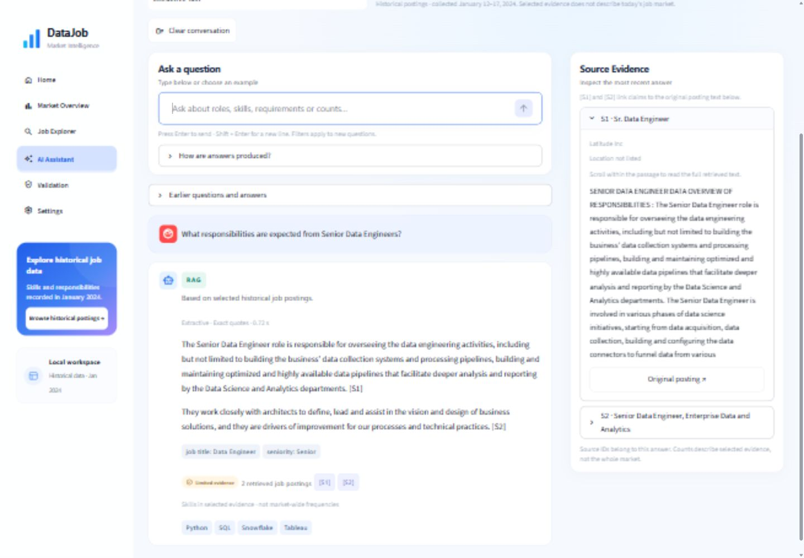
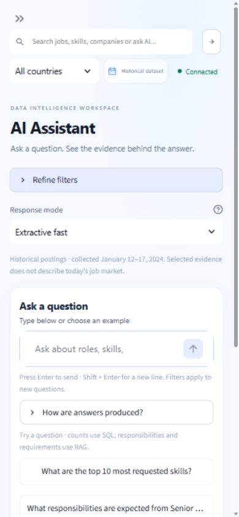

# Revue finale UI/UX — Data Job Market Intelligence

Revue commencée le 31 octobre 2026 et finalisée le 1er novembre 2026.
Périmètre : améliorations de présentation Streamlit, conservation du backend et des données.

## 1. État initial et constats

L'application possédait déjà les six pages, les cartes blanches arrondies, la palette
bleue, une navigation latérale et les graphiques interactifs. Il ne fallait pas
remplacer cette interface. Le dépôt contenait aussi de nombreuses modifications
antérieures : elles ont été conservées, sans reset, commit, staging ou push.

L'audit du code et du navigateur à une largeur de 1 440 pixels a confirmé :

- Un champ de question éloigné des exemples, fixé en bas de l'assistant, avec une
  grande zone vide à gauche du panneau de sources avant la première question.
- Des légendes, descriptions et notes de 10–11 pixels, vérifiés dans le CSS et
  le navigateur à une échelle de viewport de 1. La revue ne se fonde pas sur les
  anciennes captures prises à 50 % de zoom.
- Une sidebar avec un grand encart « real opportunities », ambigu pour un corpus
  collecté en janvier 2024.
- Des pourcentages de compétences disponibles dans les infobulles mais pas
  directement lisibles à côté des nombres.
- Des extraits de sources interrompus après environ 320 caractères alors que
  l'API renvoie aussi le passage utilisé pour la réponse.
- Un bouton d'effacement de recherche disponible seulement lorsque la recherche
  ne renvoyait aucun résultat.
- Sur tablette, quatre cartes de synthèse trop étroites et des graphiques serrés.

La page Validation avait déjà été corrigée avant cette mission : son relevé récent
annonçait **196 tests** et distinguait les preuves Docker fournies par le propriétaire.
Le chiffre de 193 indiqué dans la mission correspondait à un état antérieur. Il
n'a pas été réintroduit. Le snapshot du 11 octobre reste une archive distincte.

## 2. Éléments conservés

- Les six pages Home, Market Overview, Job Explorer, AI Assistant, Validation, Settings.
- Palette, cartes, sidebar, indicateurs, graphiques interactifs et aperçu IA de Home.
- Tous les filtres et leurs paramètres API ; recherche et pagination existantes.
- Modes Extractive fast, Generative / Ollama et Configured default.
- Routage SQL/RAG, citations, provenance, durée réelle et nombre de documents retrouvés.
- Règles de refus, contrôles des citations, grounding et fallback existants.
- SQL, modèle de données, ingestion, embeddings V1/V2 et fichiers Docker.
- README, storytelling et rapports antérieurs ; nouvelle documentation ajoutée ici.

## 3. Améliorations par page

### Home et navigation partagée

L'indicateur devient **Historical Job Postings**. Le sous-titre annonce les dates de
collecte, du 12 au 17 janvier 2024. Les quatre graphiques et l'aperçu IA restent.
L'encart latéral est plus court, sans icône décorative supplémentaire, et invite à
consulter des annonces historiques. Les liens des six pages sont conservés.

Les titres de cartes passent à 17 pixels, les notes principales à 12 pixels et
les textes de cartes d'offres à 13–14 pixels, avec un gris plus foncé. Le focus
visible, les styles de sélection et la préférence de réduction des animations restent.

### AI Assistant

Le champ de saisie est placé dans une carte visible en haut de la conversation,
à côté de Source Evidence sur grand écran. Les exemples sont regroupés sous ce
champ avant la première réponse. Une aide repliable explique SQL, RAG et [S1]/[S2].

L'état initial des sources explique leur utilité en deux phrases. Les réponses
SQL portent le libellé **SQL ANALYTICS** ; les réponses documentaires portent **RAG**.
Les réponses longues et passages sources disposent de textes plus lisibles et
d'une coupure des mots longs. Le passage complet renvoyé par l'API est affiché
quand il est disponible ; aucun texte supplémentaire n'est inventé.

Le chargement conserve un message correspondant au mode demandé. Une preuve
insuffisante possède un avertissement explicite, sans modifier le refus renvoyé
par le backend. Un échec conserve la question et permet une **relance manuelle**
avec exactement les mêmes filtres et mode. Une simple réexécution de la page ne
relance pas une requête ; une relance ne duplique pas le message utilisateur.
Les échanges antérieurs restent accessibles dans un volet repliable : la dernière
réponse reste proche de la saisie. Les longs passages sources sont intégralement
disponibles dans une zone défilante de 320 pixels, avec le lien original en dehors
de cette zone, pour ne pas repousser toutes les autres sources en bas de page.

Sur tablette, conversation et sources s'empilent. Sur mobile, les composants se
répartissent dans une colonne, conformément au fonctionnement de Streamlit.

### Market Overview

Les six visualisations restent présentes : compétences, séniorité, rôles, lieux,
type de travail et matrice Skill × Role. Les axes et infobulles sont agrandis,
l'unité « Postings » est explicite et la matrice bénéficie de davantage de hauteur
et de marges. Un tableau repliable permet de lire les valeurs de la matrice sans
dépendre uniquement d'une couleur ou d'une infobulle.

Les compétences affichent nombre et pourcentage du total filtré. Une annonce peut
mentionner plusieurs compétences : les parts ne constituent pas un découpage
exclusif du corpus. « Other / Unclassified » désigne des titres hors des familles
suivies, conservés dans les totaux. Les dates et l'absence de tendance actuelle
sont rappelées en haut. Un indicateur de chargement accompagne le changement de filtres.

Sur tablette, les cartes de synthèse occupent deux colonnes et les graphiques
s'empilent pour garder des axes et légendes lisibles.

### Job Explorer

Les cartes conservent titre, société, lieu, séniorité, compétences, description
complète et lien source. Les descriptions et métadonnées sont plus lisibles.
La recherche active peut être effacée même si elle renvoie des résultats ; le
champ et la pagination sont réinitialisés ensemble par un callback Streamlit.
Les états de chargement et sans résultat restent explicites. Le sous-titre
précise que la disponibilité actuelle des anciennes annonces n'est pas garantie.

### Validation

La page distingue la méthode, la date et le périmètre du relevé récent de
l'évaluation historique. Le relevé courant est porté à **202 tests**, après une
exécution complète renouvelée le 1er novembre, dont les trois tests PostgreSQL.
L'ancien relevé de 196 tests reste documenté dans les rapports précédents.

Le fichier `app/assets/validation_snapshot.json` du 11 octobre reste inchangé :
**61 tests, 3 tests PostgreSQL et 19/20 critères à cette date**. L'absence de
validation Docker complète de ce snapshot n'est pas réécrite a posteriori.

Les preuves de conteneurs healthy, SQL et RAG extractif sur Supabase sont toujours
attribuées au propriétaire, signalées le 31 octobre. Cette mission ne les transforme
pas en validation de CI hébergée, de génération dans Docker ou de déploiement public.
Les cartes de validation passent sur deux colonnes sur tablette.

### Settings

Les réglages sont regroupés sous **Display Preferences** et le diagnostic sous
**Technical Information**. Les options existantes restent actives. Le bouton
**Refresh displayed data** vide les caches UI ; il ne lance ni ingestion ni
réindexation. Aucun identifiant de connexion ni secret n'est affiché.

## 4. Tests et vérifications mesurés

| Vérification | Résultat et périmètre |
| --- | --- |
| Suite complète avec `--live` | 202 tests réussis, dont 3 PostgreSQL, 28,46 s, 1er novembre ; passe précédente de 38,06 s le 31 octobre |
| Dernière régression UI ciblée | 34 tests réussis, 4,37 s, 1er novembre, après l'ajout du défilement des passages |
| Ruff | `ruff check .` réussi après suppression d'un import devenu inutilisé |
| Format Python | `ruff format --check .` réussi, 127 fichiers déjà formatés lors de la dernière suite complète |
| Avertissements Pytest | 2 avertissements de dépréciation Starlette/httpx et AnyIO ; aucun échec |
| Syntaxe/imports | Pages exécutées dans le navigateur ; modules UI importés par les tests |
| Git | `git diff --check` : code 0 ; avertissement de conversion CRLF → LF du CSS, sans erreur d'espaces |
| Préservation | Comparaison SHA-256 de 90 fichiers protégés : aucune différence |

Six tests supplémentaires couvrent la reprise manuelle sans répétition automatique,
la conservation des filtres/modes, l'absence d'appel en état initial, l'intégrité
des valeurs de matrice et des pourcentages filtrés, l'échappement des noms de
compétences, le passage source complet et le message de preuves insuffisantes.
Certains tests couvrent plusieurs de ces contrats dans un même scénario.

Les nouveaux tests s'ajoutent aux tests préexistants des modes, durées, refus,
fallback, provenance et conservation du snapshot historique.

### Compatibilité API

Mesures HTTP effectuées le 31 octobre sur l'API existante au port 8002.
Ces temps sont des observations ponctuelles, pas un benchmark comparatif.

| Méthode et route | HTTP | Temps client mesuré |
| --- | --- | --- |
| GET /health | 200 | 0,517 s |
| GET /api/analytics/overview | 200 | 8,359 s |
| GET /api/analytics/skills | 200 | 0,916 s |
| GET /api/analytics/jobs | 200 | 1,735 s |
| POST /api/assistant/query | 200 | 5,297 s |
| POST /api/rag/query | 200 | 7,332 s |
| GET /api/system/status, diagnostic supplémentaire | 200 | 3,252 s |

À la reprise du 1er novembre, les ports 8002/8502 ne répondaient plus. Aucun
conteneur n'a été reconstruit ou reconfiguré. La prévisualisation a été relancée
avec FastAPI natif au port 8000 et Streamlit au port 8503, avec une surcharge
`STREAMLIT_API_URL` limitée au processus. `/health` confirme alors la connexion,
12 217 offres, 30 955 chunks et un index prêt. Le véritable `.env` n'a pas changé.

### Données et traçabilité

Une transaction SQL explicitement **READ ONLY** a confirmé :

| Élément | Nombre constaté |
| --- | ---: |
| Offres | 12 217 |
| Chunks V1 conservés | 23 638 |
| Chunks V2 | 30 955 |
| Embeddings V2 non nuls | 30 955 |

La ligne d'état 2 indique `version=v2`, `partial=false`, 12 217 offres et 30 955
chunks. Les tests PostgreSQL vérifient aussi dimensions, index et liens vers les
offres. Aucun ETL, bootstrap, migration ou recalcul des embeddings du corpus n'a été
lancé ; les questions utilisent normalement un embedding de requête pour la recherche.

Pour la question Senior Data Engineer, S1 correspond à l'offre
`fe62ee62d0f9756ad8242a141dccecd1` et S2 à
`fdb4382efaff3190f134df501f3031dc`. Les deux offres existent, leurs URL concordent
avec PostgreSQL, leurs passages existent dans V2 et les citations exactes sont
présentes dans les passages renvoyés. Ce contrôle ne constitue pas une nouvelle
évaluation de pertinence de toutes les réponses possibles.

## 5. Parcours manuels déjà observés

| Parcours | Observation |
| --- | --- |
| Question Python dans l'assistant | Route SQL, 5 121/12 217, 41,92 %, sources documentaires non requises |
| Responsabilités Senior Data Engineer | Route RAG, mode Extractive, deux offres et citations S1/S2 visibles |
| Recherche globale au clavier, « Python » | Redirection vers Job Explorer, 4 851 correspondances textuelles |
| Question depuis la recherche globale | Routage vers AI Assistant puis réponse SQL Python ; la question suivante reçoit une réponse RAG, avec l'échange précédent conservé dans le volet historique |
| Recherche sans résultat | 0 résultat et message explicite ; Clear search permet le retour |
| Pagination | Passage de 1–12 à 13–24, page 2/1 019 sans recherche |
| Préférences | 6 cartes/page réellement affichées ; aperçu non compact de 274–279 caractères observé |
| Filtre Canada | UI et API concordent : 625 offres, Python 313, soit 50,08 % |
| Graphiques | Six catégories conservées : cinq figures Plotly et les barres de compétences HTML |
| Tableau Skill × Role | Ouvert sur mobile ; valeurs structurées accessibles en complément des couleurs |
| Home | Libellé historique, dates, quatre indicateurs, trois figures Plotly plus barres HTML et aperçu IA présents |
| Validation | 202 tests affichés ; archive du 11 octobre et méthodes de vérification séparées |
| Settings | Bouton de rafraîchissement actionné ; état V2 et 30 955 vecteurs affichés ; option technique activée, puis volet correspondant visible dans l'assistant |

La recherche libre « Python » et le filtre de compétence Python correspondent à
des critères différents. Les 4 851 résultats textuels ne doivent pas être présentés
comme le décompte analytique de 5 121 offres mentionnant la compétence normalisée.

Résolutions contrôlées : desktop 1 440 × 1 000 et tablette 1 024 × 768 ;
Market Overview et AI Assistant à 390 × 844. Sur l'assistant mobile, le champ de
saisie est visible vers y=555 et les cartes de saisie/sources occupent une largeur
de 348 pixels, en une colonne. Les mesures DOM confirment une échelle de viewport 1
et l'absence de débordement horizontal global sur ces vues. Cela ne vaut pas
certification d'accessibilité ou test sur un téléphone physique.

## 6. Fichiers de cette mission

- `app/Home.py`
- `app/components/dashboard.py`
- `app/components/design.py`
- `app/components/charts.py`
- `app/components/ui.py`
- `app/assets/theme.css`
- `app/assets/current_validation.json`
- `app/pages/1_Market_Overview.py`
- `app/pages/2_Job_Explorer.py`
- `app/pages/3_AI_Assistant.py`
- `app/pages/4_Validation.py`
- `app/pages/5_Settings.py`
- `tests/test_assistant_ui.py`
- `tests/test_chart_evidence_ui.py` (nouveau)
- `docs/UI_UX_FINAL_REVIEW.md` (nouveau)
- `docs/assets/ui-ux-assistant-mobile-2026-11-01.jpg` (capture de contrôle)
- `docs/assets/ui-ux-assistant-desktop-2026-11-01.jpg` (capture avec réponse, S1/S2 et nombre de preuves)

Cette liste décrit les changements de la mission, pas toutes les modifications
déjà présentes dans le dépôt avant son début.

## 7. Preuves locales et limites

Les mesures détaillées sont conservées localement sous
`evaluation/results/ui-ux-final-review-2026-10-31/`, dossier ignoré par Git :
`final-checks.json`, `final-ui-quality.json`, `api-checks.json`,
`final-checks-2026-11-01.json`,
`database-evidence.json`, `filter-check.json`, `rag-evidence.json`,
`protected-before.json` et `preservation-check.json`.

L'inspection locale finale de secrets du 1er novembre a examiné **435 fichiers texte** :
aucun résultat détecté, `.env` ignoré et non suivi, champs secrets de `.env.example`
sous forme de placeholders. Le périmètre inclut les fichiers texte courants et les
logs/rapports locaux, pas l'intégralité de l'historique Git, les captures d'écran,
l'historique du terminal ou les services externes. Les captures livrées ont été
inspectées visuellement ; elles montrent l'interface, sans identifiants de connexion.

La première passe de lint a signalé une ligne trop longue et une différence de
formatage ; après la clarification des badges, un import inutilisé a été retiré.
Les derniers contrôles Ruff et format passent. Les anciens résultats d'échec
restent dans les traces locales ; ils ne sont pas présentés comme des échecs actuels.

Limites à conserver avant publication :

- La nouvelle interface est prévisualisée nativement. Une image Docker déjà
  construite embarque l'ancien code : cette mission n'a pas reconstruit le frontend.
- Les modes génératifs sont conservés et couverts par des tests de contrat ; aucun
  nouveau benchmark Ollama ou test de génération dans Docker n'est revendiqué ici.
- Les états échec/relance et preuves insuffisantes sont couverts par les tests UI ;
  aucune panne volontaire de Supabase n'a été provoquée.
- Les URL des annonces sont affichées et reliées aux enregistrements ; leur
  disponibilité actuelle chez LinkedIn n'est pas garantie.
- Pas d'audit complet lecteur d'écran/WCAG, de tous les navigateurs ou de tous les
  breakpoints ; la matrice possède un tableau pour les petits écrans.
- L'exécution GitHub Actions hébergée et le déploiement public restent non vérifiés.
- La rotation du mot de passe PostgreSQL anciennement exposé reste à confirmer par
  le propriétaire. Une inspection locale sans résultat ne prouve pas sa rotation.

Après le premier push, les améliorations utiles seraient une campagne manuelle sur
téléphone réel et lecteur d'écran, ainsi qu'une exécution de la CI hébergée. La
validation d'une nouvelle image frontend peut être faite séparément par le propriétaire.

Les 90 empreintes de protection couvrent `.env`, Docker/Compose, backend `api/`
et `src/`, configuration, anciens rapports, README et snapshot historique. Elles
confirment la préservation de ces fichiers pendant cette mission. Les vérifications
base de données et requêtes API ont été réalisées en lecture ; aucun mécanisme
de modification des données n'a été appelé. Aucun commit ni push n'a été réalisé.

Contrôle final : les ports natifs 8000 et 8503 répondent HTTP 200. HEAD reste
`32ac590d4e800532182676e7a6aee723ae48a4c1` ; les améliorations UI sont des changements
locaux non commités. La taille temporaire du navigateur a été réinitialisée après
les essais responsive. La prévisualisation peut être ouverte à
<http://127.0.0.1:8503/AI_Assistant> tant que les processus natifs sont actifs.

