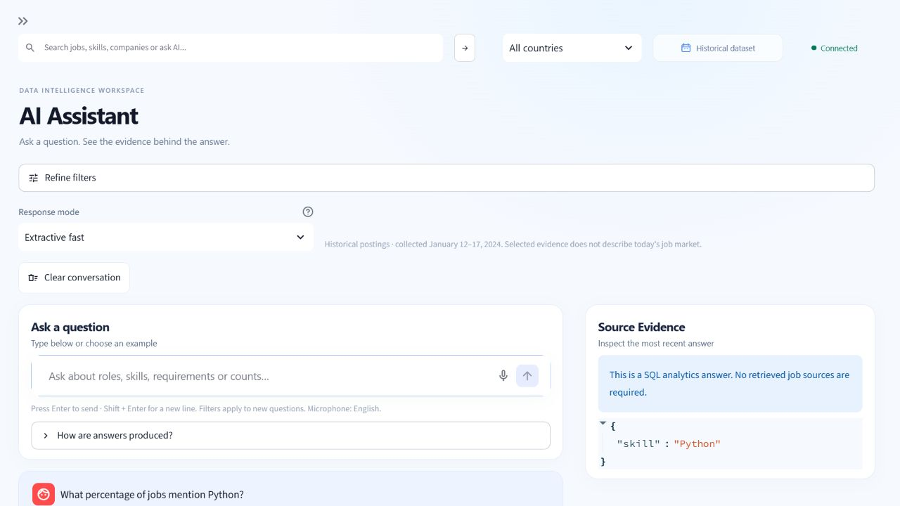

# Saisie vocale - guide et validation

Data Job Market Intelligence - 1 novembre 2026.

## Fonctionnement livré

Une simple **icône de microphone**, intégrée à droite dans le champ de question,
remplace le bouton vocal textuel sur la version Streamlit installée. Le clic active
le microphone natif et demande l'autorisation du navigateur si nécessaire. Après
l'arrêt, la flèche envoie l'audio à Vosk pour transcription sur le serveur Streamlit.
Un champ **Review and edit your question** permet de corriger les noms et termes
techniques. **Send question** est la seule action qui transmet ce brouillon au
traitement habituel ; **Discard transcription** permet de l'abandonner.

Le texte confirmé utilise `/api/assistant/query`, les filtres et le mode de réponse
courants. SQL/RAG, réponses, citations, preuves et refus restent ceux du pipeline
existant. Un brouillon, une correction ou une simple réexécution de Streamlit ne
déclenche aucun appel de question. L'ancien mécanisme de relance API est conservé.
La flèche de l'enregistrement lance uniquement sa transcription ; **Send question**
confirme ensuite le texte pour SQL/RAG. Si du texte accompagnait l'audio, il est
conservé dans le brouillon à relire.

## Essayer sur ce PC

Le module et le petit modèle anglais sont déjà installés dans le `.venv` du projet.

1. Garder FastAPI sur le port 8000 et Streamlit sur le port 8503 en fonctionnement.
2. Ouvrir `http://127.0.0.1:8503/AI_Assistant` dans Chrome ou Edge, puis actualiser.
3. Cliquer le symbole microphone à droite du champ de question.
4. Autoriser le microphone dans le navigateur si une demande apparaît.
5. Dire une question en anglais, arrêter, puis cliquer la flèche pour la transcription.
6. Attendre la transcription, la relire et corriger les erreurs éventuelles.
7. Cliquer **Send question**. Vérifier la route, la réponse et les sources comme avant.

Exemples : « What percentage of jobs mention Python? » et « What responsibilities
are expected from senior data engineers? ». Le français n'est pas annoncé comme
pris en charge : aucune validation conjointe transcription/routage en français
n'a été effectuée.

Si le bouton n'apparaît pas après actualisation, arrêter seulement Streamlit avec
Ctrl+C dans son terminal, puis le relancer depuis le dossier de l'application :

```powershell
$env:STREAMLIT_API_URL='http://127.0.0.1:8000'
.\.venv\Scripts\python.exe -m streamlit run app/Home.py `
  --server.address 127.0.0.1 --server.port 8503
```

## Choix technique et ressources

Version installée et inspectée : **Streamlit 1.64.0**, avec `st.audio_input` natif.
Le code détecte également l'absence de ce widget et les anciennes signatures sans
`sample_rate`, afin de conserver une saisie texte utilisable. Ces autres versions
ne constituent pas des environnements complets validés pendant cette mission.
Référence : [microphone natif Streamlit](https://docs.streamlit.io/develop/api-reference/widgets/st.audio_input).

Moteur : **Vosk 0.3.45**, optionnel, avec **vosk-model-small-en-us-0.15**. Aucune API
payante, clé de transcription, carte graphique, dépendance Whisper/PyTorch ou
installation FFmpeg n'est ajoutée. Le modèle n'est chargé qu'au premier
enregistrement et reste partagé en mémoire dans le processus Streamlit. Chaque
transcription dispose d'un reconnaisseur distinct ; aucun audio n'est mis en cache.

L'archive officielle téléchargée mesure **41 205 931 octets**, et le modèle extrait
**70 898 967 octets**. Les fichiers du modèle restent dans `data/models/`, ignoré par
Git. Le téléchargement est une étape d'installation ; aucune récupération de modèle
n'est effectuée pendant la transcription.
Le modèle anglais est publié sous licence Apache 2.0 selon le
[catalogue officiel Vosk](https://alphacephei.com/vosk/models).

Le petit Vosk a été retenu pour une première saisie anglaise CPU, avec correction
manuelle obligatoire avant envoi. Whisper peut être évalué plus tard si une meilleure
reconnaissance des termes métiers est nécessaire ; aucun comparatif de précision
entre moteurs n'a été réalisé. La reconnaissance vocale fournie directement par
certains navigateurs n'a pas été retenue, afin de ne pas dépendre de leur service
de transcription et de ses modalités de traitement externe.

## Installation sur un autre environnement

Depuis le dossier de l'application :

```powershell
.\.venv\Scripts\python.exe -m pip install -r requirements-voice.txt
Invoke-WebRequest `
  -Uri 'https://alphacephei.com/vosk/models/vosk-model-small-en-us-0.15.zip' `
  -OutFile 'data/models/vosk-model-small-en-us-0.15.zip'
Expand-Archive `
  -LiteralPath 'data/models/vosk-model-small-en-us-0.15.zip' `
  -DestinationPath 'data/models' -Force
```

Cette installation est facultative. Sans dépendance ou sans modèle, le microphone
est désactivé avec une explication et le clavier reste disponible. Un autre
emplacement peut être indiqué par la variable de processus `DJMI_VOICE_MODEL_PATH`,
pointant vers le dossier du modèle extrait. Le véritable `.env` n'a pas été modifié.

Windows x64 / Python 3.11 a été exécuté réellement. Pour WSL2, installer la dépendance
dans un environnement Python Linux distinct et utiliser le navigateur Windows sur
localhost ; les fichiers du modèle peuvent être partagés. La capture se fait dans
le navigateur, sans accès direct à un périphérique audio depuis Python ou Linux.
WSL2 et Docker n'ont pas fait l'objet d'une nouvelle exécution vocale pendant cette
mission. Vosk dispose de distributions Linux x86_64 ; l'image Python slim existante
est une cible compatible attendue, à valider dans son environnement final.

## Confidentialité et erreurs

L'autorisation est demandée par le navigateur lorsque l'utilisateur active le
microphone. Il faut localhost, ou HTTPS pour un serveur distant. Un refus, l'absence
de périphérique ou une politique du navigateur est géré par le contrôle natif ;
une aide repliable explique comment vérifier l'autorisation et revenir au clavier.
Le Python ne peut pas distinguer tous les refus navigateur d'un état « pas encore
d'enregistrement ». Aucun statut de permission n'est inventé à partir d'un audio nul.
Ces conditions de navigateur sont décrites dans
[MDN - getUserMedia](https://developer.mozilla.org/en-US/docs/Web/API/MediaDevices/getUserMedia).

L'audio voyage du navigateur vers **le serveur Streamlit** : si ce serveur est distant,
il reçoit l'enregistrement. Il n'est pas transmis à une API de reconnaissance vocale.
Le code de l'application ne crée aucun fichier audio, ne journalise pas son contenu
et ne conserve pas d'audio dans son cache. Le widget et les buffers utilisent
temporairement la mémoire du navigateur/serveur ; il ne s'agit pas d'une garantie
d'effacement sécurisé de chaque copie en mémoire ou dans une éventuelle capture
réseau externe. Le texte confirmé suit ensuite les règles du fournisseur SQL/RAG/LLM
déjà configuré ; choisir un fournisseur distant conserve ses implications habituelles.

Les fichiers WAV doivent être mono PCM 16 bits, 16 kHz et au maximum 30 secondes.
La taille est contrôlée avant copie, puis le conteneur et sa durée sont validés.
Une absence d'audio, du silence, un fichier corrompu ou une erreur du décodeur
produit un message fixe, sans détail interne ni contenu audio. La limite est
vérifiée après l'arrêt ; elle n'arrête pas automatiquement un enregistrement long.

L'envoi natif consomme l'enregistrement comme un événement unique. L'application ne conserve que
l'empreinte de l'événement, le brouillon texte et un éventuel message d'erreur.
L'empreinte évite une seconde transcription du même événement. Une nouvelle
transcription remplace le brouillon précédent, et un échec ne laisse pas un ancien
brouillon prêt à être envoyé par erreur. La confirmation consomme le brouillon une
seule fois, puis laisse le mécanisme existant de relance gérer un éventuel échec API.

## Résultats réellement mesurés

### Tests automatiques

**236 tests réussis, 3 tests PostgreSQL désélectionnés, 2 avertissements de dépendances,
en 25,39 secondes.** Ruff et `ruff format --check .` passent ; 130 fichiers Python
étaient déjà formatés lors de cette passe. Les 37 nouveaux cas couvrent la voix, les erreurs, le brouillon,
la correction, la confirmation, les réexécutions, la consommation unique, la mémoire,
les signatures de widgets et les modes/filtres de l'assistant existant.

Un test **Streamlit AppTest** vérifie réellement le champ d'édition, l'absence d'envoi
lors d'une correction, le clic de confirmation et l'absence de doublon à la
réexécution. Les autres tests de page remplacent les appels réseau par des doubles.
La suite n'exige ni microphone, ni téléchargement de modèle, ni installation de Vosk.
Les scénarios de décodeur emploient des doubles ; les essais réels ci-dessous
complètent cette couverture. Le délai AppTest est réglé à 15 secondes après un
dépassement initial de son délai par défaut de 3 secondes sur ce PC.
Après l'ajustement de fermeture du panneau à la confirmation, les tests UI ciblés
ont repassé : **66 réussis en 9,11 secondes**, avec Ruff et formatage validés.
Ce relevé concerne la première présentation du contrôle vocal.
La simplification suivante ajoute cinq cas pour le microphone intégré : **71 tests
UI réussis en 4,42 secondes**, avec Ruff et formatage validés. Le total des cas du
fichier vocal est alors de 42. Le contrôle textuel repliable reste seulement une
compatibilité pour les versions sans microphone natif dans `st.chat_input`.

### Transcription réelle et API

Deux questions ont été générées avec **Microsoft Zira Desktop / Windows SAPI**,
en PCM mono 16 kHz. Cette voix synthétique est uniquement une fixture d'évaluation,
pas une dépendance de l'application. L'audio a été généré et traité en mémoire,
sans fichier audio. Le texte décodé a été envoyé à l'API existante en mode Extractive.

| Question reconnue | Audio | STT | Route / résultat |
| --- | --- | --- | --- |
| what percentage of jobs mention python | 3,085 s | 7,164 s, premier chargement | SQL Analytics, HTTP 200, 5 121 / 12 217 = 41,92 % |
| what responsibilities are expected from senior data engineers | 4,335 s | 5,208 s, modèle déjà chargé | RAG, HTTP 200, deux sources S1 et S2 |

Les appels API ont pris respectivement **6,814 s** et **7,546 s** en plus de la STT.
Dans le processus isolé de validation, le jeu de travail mémoire est passé de
**27,85 Mio** à **155,72 Mio**, avec un pic de **182,94 Mio**. Ce chiffre ne mesure
pas la mémoire totale de Streamlit, de l'API, des embeddings, du navigateur ou
d'Ollama. Les temps CPU de transcription étaient 5,406 s et 4,781 s. Deux essais
synthétiques ne permettent pas d'annoncer un score de précision ou une garantie
de performance pour tous les micros, accents ou termes métiers sur un PC de 8 Go.

### Navigateur et limites

L'icône intégrée et le contrôle natif d'enregistrement, les explications, l'état initial
et la conservation de la saisie clavier ont été inspectés dans le navigateur.
Le microphone physique, le dialogue réel d'autorisation/refus et un parcours vocal
de bout en bout sur Chrome/Edge, WSL2 et Docker restent à tester par l'utilisateur.
Les erreurs de périphérique/permission sont couvertes par des doubles Python ;
cela ne constitue pas un essai matériel. Aucun audio ambiant n'a été enregistré.

Les snapshots de validation restent à leur valeur et date historiques : le relevé
de 202 tests avec PostgreSQL n'est pas remplacé par ce nouveau relevé hors base externe.
La comparaison SHA-256 de **67 fichiers protégés** n'a montré aucun changement :
backend, logique SQL/RAG, configuration Docker, `.env` et deux relevés de validation.
L'API confirme toujours **12 217 offres, 30 955 chunks et un index prêt**.

## Docker : changements futurs nécessaires, non appliqués

Aucun Dockerfile/Compose n'a changé, aucune image n'a été construite. Pour embarquer
la voix lors d'une opération future explicitement autorisée, il faudra installer
`requirements-voice.txt` dans l'image **frontend**, et fournir le modèle à ce même
conteneur, par exemple avec un montage en lecture seule et `DJMI_VOICE_MODEL_PATH`.
Le montage actuel du modèle de données dans le service API ne suffit pas au frontend.
Pas besoin d'accès à un micro du conteneur, de périphérique audio, de GPU ou d'un
service STT séparé : c'est le navigateur client qui capture le son.

## Fichiers de cette modification

- `app/voice_transcription.py` : validation WAV, transcription locale et cache du modèle.
- `app/components/voice_input.py` : microphone, états, brouillon modifiable et confirmation.
- `app/pages/3_AI_Assistant.py` : branchement du texte confirmé sur le traitement existant.
- `requirements-voice.txt` : dépendance facultative Vosk 0.3.45.
- `tests/test_voice_input.py` : 42 cas automatisés, dont Streamlit AppTest.
- `tests/test_assistant_ui.py` : isolation de l'entrée vocale dans les anciens tests clavier.
- `docs/VOICE_INPUT.md` : source de ce guide, installation, mesures et limites.
- `docs/assets/voice-input-2026-11-01.jpg` : capture du contrôle natif.
- `output/pdf/Data_Job_Market_Intelligence_Voice_Input.pdf` : rapport livré en PDF.

Mesures détaillées locales : `evaluation/results/voice-input-2026-11-01/`.
Le modèle téléchargé est ignoré par Git. Aucun commit ni push n'a été effectué.

## Sources techniques

- [Streamlit : st.audio_input](https://docs.streamlit.io/develop/api-reference/widgets/st.audio_input)
- [Vosk : modèles et ressources annoncées](https://alphacephei.com/vosk/models)
- [Vosk : plateformes et installation](https://alphacephei.com/vosk/install)
- [MDN : microphone, autorisation et contexte sécurisé](https://developer.mozilla.org/en-US/docs/Web/API/MediaDevices/getUserMedia)


