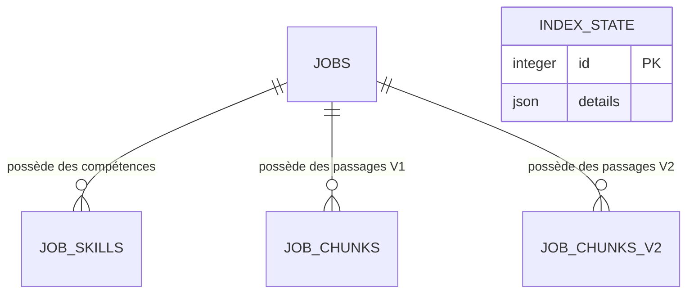

# Atelier SQL : tables, JOIN, CTE et fonctions de fenêtre

Date : **19 octobre 2026**. Branche de travail : `codex/prise-en-main`.

Objectif : comprendre les relations du modèle métier, puis exécuter trois
requêtes sur les offres et les compétences. Toutes les opérations PostgreSQL de
cet atelier sont exécutées en **lecture seule**. Aucun chargement de données,
déplacement de table, changement de configuration ou recalcul d'index n'a eu lieu.

## 1. Première découverte : vérifier le schéma physique

La configuration et les anciens documents désignent `djmi` comme schéma de
l'application. L'audit réel a révélé une différence à connaître :

- le schéma `djmi` existe, mais ne contient aucune des cinq tables applicatives ;
- les tables `jobs`, `job_skills`, `job_chunks`, `job_chunks_v2` et `index_state`
  sont actuellement dans **`public`** ;
- les requêtes utilisant les noms de table seuls se résolvent vers `public` dans
  la connexion examinée. `current_schema()` retourne `public` ;
- les modèles SQLAlchemy ne déclarent pas de schéma explicite sur leurs tables.
  Le nom demandé dans la configuration ne prouve donc pas leur emplacement.

La tentative initiale de lire `djmi.jobs` a renvoyé « relation does not exist ».
L'inspection des catalogues a ensuite identifié les tables réelles. Aucune table
n'a été créée ou déplacée pour contourner cette différence. Les trois exercices
qualifient volontairement leurs tables avec **`public.`** pour fonctionner sur
la base effectivement observée.

Voici une inspection reproductible des emplacements, sans lecture de secrets :

```sql
BEGIN READ ONLY;

SELECT EXISTS (
    SELECT 1
    FROM pg_catalog.pg_namespace
    WHERE nspname = 'djmi'
) AS schema_djmi_existe;

SELECT table_schema, table_name
FROM information_schema.tables
WHERE table_schema IN ('djmi', 'public')
  AND table_name IN (
      'jobs', 'job_skills', 'job_chunks', 'job_chunks_v2', 'index_state'
  )
ORDER BY table_schema, table_name;

ROLLBACK;
```

Résultat mesuré : le premier SELECT retourne `true` ; le second retourne les
cinq tables dans `public`, sans ligne dans `djmi`.

Le schéma `job_market` appartient à l'autre pipeline du poste. Ses tables ne sont
pas substituées à celles de cet atelier. Une éventuelle migration vers `djmi`
constituerait un travail séparé ; elle n'est pas nécessaire pour lire les données.

## 2. Les tables et leurs relations

Les volumes suivants ont été relus dans PostgreSQL le 19 octobre 2026.

| Table physique | Une ligne représente | Clé primaire | Relation | Lignes |
| --- | --- | --- | --- | ---: |
| `public.jobs` | Une offre d'emploi | `id` | Table parent | 12 217 |
| `public.job_skills` | Une association offre–compétence | `(job_id, skill)` | `job_id` → `jobs.id` | 40 630 |
| `public.job_chunks` | Un passage avec son embedding V1 | `chunk_id` | `job_id` → `jobs.id` | 23 638 |
| `public.job_chunks_v2` | Un passage avec son embedding V2 | `chunk_id` | `job_id` → `jobs.id` | 30 955 |
| `public.index_state` | Les métadonnées d'une version d'index | `id` | Aucune clé étrangère déclarée | 2 |



Le diagramme montre les relations déclarées ; il n'affirme pas qu'une offre doit
nécessairement avoir une compétence ou un passage. `index_state` est indépendante
au sens des clés étrangères : ses liens avec les index sont gérés par le code.

**Clé primaire (PK).** Elle identifie une ligne de façon unique. Dans `jobs`,
`id` identifie l'offre. Dans `job_skills`, c'est le couple `(job_id, skill)` qui
est unique : une offre peut avoir plusieurs compétences, mais pas deux fois le
même libellé.

**Clé étrangère (FK).** `job_skills.job_id` doit correspondre à un `jobs.id`
existant. Les trois FK des compétences et chunks ont `ON DELETE CASCADE` :
une suppression du parent supprimerait ses lignes associées. Cet atelier
n'exécute aucune suppression.

**Cardinalité.** La relation offre–compétences est un-à-plusieurs. Il n'existe
pas de table de référence `skills` séparée dans ce modèle ; `skill` est un texte
de l'association. La colonne JSON `jobs.skills` conserve également la liste des
compétences, tandis que `job_skills` permet les jointures et agrégations SQL.

Chaque table de chunks possède aussi un index unique sur `(job_id, chunk_index)`.
Il n'y a aucune FK reliant les chunks V1 aux chunks V2.

Mesures de couverture : **9 191 offres ont au moins une compétence extraite** et
**3 026 n'en ont aucune**. Les trois vérifications d'orphelins, sur les compétences
et les deux tables de chunks, retournent zéro.

## 3. Exercice JOIN : relier une offre à sa compétence

Fichier à ouvrir : [01_join_offres_python.sql](sql/01_join_offres_python.sql).

Question : **quelles offres Data Engineer mentionnent Python ?** Le fichier
affiche un échantillon ordonné de 20 offres, avec leur identifiant, leur titre,
leur entreprise, leur pays et la compétence Python.

Le cœur de la jointure est :

```sql
FROM public.jobs AS j
INNER JOIN public.job_skills AS js
    ON js.job_id = j.id
```

`j` et `js` sont des alias. `ON` indique la relation entre les lignes. `INNER JOIN`
ne conserve que les associations existantes. Les conditions `WHERE` retiennent
ensuite le rôle normalisé Data Engineer et la compétence Python.

La clé primaire composite garantit au plus une association Python par offre.
Sans filtre sur une compétence unique, la même offre peut apparaître plusieurs
fois, une fois pour chaque compétence associée.

Un `LEFT JOIN` garderait aussi les offres sans compétence, avec des valeurs
nulles pour les colonnes de droite. Attention : ajouter ensuite
`WHERE js.skill = 'Python'` éliminerait ces lignes sans association.

**Résultat mesuré :** le SELECT de l'exercice retourne 20 offres distinctes.
Une vérification indépendante des identifiants et compétences trouve
**1 399 offres Data Engineer mentionnant Python au total**. `LIMIT 20` réduit
l'affichage ; il ne signifie pas qu'il n'y a que 20 correspondances.

Référence : [jointures PostgreSQL](https://www.postgresql.org/docs/current/tutorial-join.html).

## 4. Exercice CTE : calculer le top 10 des compétences

Fichier : [02_cte_top_competences.sql](sql/02_cte_top_competences.sql).

Une **CTE**, ou Common Table Expression, nomme une sous-requête grâce à `WITH`.
Son résultat peut être utilisé dans la requête principale. Ici, les deux CTE
contiennent uniquement des SELECT et ne créent aucune table permanente :

1. `total_offres` calcule le dénominateur : toutes les lignes de `jobs` ;
2. `offres_par_competence` compte les offres distinctes pour chaque compétence ;
3. le SELECT final combine les deux résultats et calcule le pourcentage.

`CROSS JOIN total_offres` ajoute l'unique ligne contenant le dénominateur à chaque
compétence. Il ne multiplie donc pas ici le nombre de lignes. `100.0` permet une
division décimale ; `NULLIF(nb_total, 0)` évite une division par zéro.

Le dénominateur est **12 217 offres**, incluant les **3 026 offres sans compétence
extraite**. Le remplacer par la taille de la jointure ou par les seules offres
avec compétences changerait la question et produirait un autre pourcentage.

| Compétence | Offres | Pourcentage des 12 217 offres |
| --- | ---: | ---: |
| SQL | 5 592 | 45,77 % |
| Python | 5 121 | 41,92 % |
| Machine Learning | 3 324 | 27,21 % |
| AWS | 2 816 | 23,05 % |
| Azure | 2 156 | 17,65 % |
| Spark | 2 076 | 16,99 % |
| Excel | 1 956 | 16,01 % |
| Tableau | 1 828 | 14,96 % |
| Power BI | 1 664 | 13,62 % |
| GCP | 1 466 | 12,00 % |

Une offre peut mentionner plusieurs compétences : la somme des pourcentages n'a
pas à faire 100 %. Une mention extraite n'est pas nécessairement une exigence
obligatoire du recruteur.

Référence : [CTE PostgreSQL](https://www.postgresql.org/docs/current/queries-with.html).

## 5. Exercice de fenêtre : classer les compétences par métier

Fichier : [03_fenetre_competences_par_metier.sql](sql/03_fenetre_competences_par_metier.sql).

Question : **quelles compétences occupent les trois premiers rangs de fréquence
dans chaque métier ?**

`GROUP BY` calcule d'abord une ligne par couple métier–compétence. La fonction de
fenêtre ajoute ensuite une colonne de classement, en conservant ces lignes :

```sql
DENSE_RANK() OVER (
    PARTITION BY metier
    ORDER BY nb_offres DESC
) AS rang
```

- `OVER` décrit la fenêtre utilisée pour le calcul ;
- `PARTITION BY metier` recommence le classement pour chaque métier ;
- `ORDER BY nb_offres DESC` place les fréquences les plus élevées en premier ;
- `DENSE_RANK` attribue le même rang aux ex æquo, sans trou entre les rangs ;
- la CTE suivante permet de filtrer le rang calculé avec `WHERE rang <= 3`.

Exemple purement pédagogique, **pas une mesure du projet** : des fréquences
`100, 100, 80, 60` donnent les rangs `1, 1, 2, 3`. Quatre lignes occupent donc les
trois premiers rangs. Pour obtenir exactement trois lignes par métier, on
utiliserait `ROW_NUMBER()` avec un tri déterministe `nb_offres DESC, skill`.

Ne pas ajouter `skill` au tri de `DENSE_RANK` : cela distinguerait deux compétences
ayant le même nombre d'offres. Le nom est trié seulement dans le résultat final.

Résultats réels pour deux métiers :

| Métier | Compétence | Offres | Rang |
| --- | --- | ---: | ---: |
| Data Analyst | SQL | 1 350 | 1 |
| Data Analyst | Python | 964 | 2 |
| Data Analyst | Tableau | 867 | 3 |
| Data Engineer | SQL | 1 448 | 1 |
| Data Engineer | Python | 1 399 | 2 |
| Data Engineer | Spark | 1 023 | 3 |

L'exercice complet retourne **43 lignes pour 10 catégories de métiers**, avec
les ex æquo conservés. La catégorie Other / Unclassified reste incluse.

Référence : [fonctions de fenêtre PostgreSQL](https://www.postgresql.org/docs/current/tutorial-window.html).

## 6. Éviter les erreurs de comptage

- Après `jobs JOIN job_skills`, `COUNT(*)` compte les associations, pas forcément
  les offres. `COUNT(DISTINCT j.id)` compte les offres distinctes.
- Joindre aussi les chunks produit une multiplication : un exemple fictif avec
  cinq compétences et quatre chunks pour une offre donne vingt lignes.
- `COUNT(DISTINCT)` protège le nombre d'offres, mais ne corrige pas automatiquement
  une somme ou une moyenne et ne rend pas la jointure inutile moins coûteuse.
- Les chunks et embeddings ne sont pas nécessaires pour ces trois exercices
  analytiques : seules `jobs` et `job_skills` sont jointes.
- Les données sont l'instantané historique collecté en janvier 2024. Ces requêtes
  ne mesurent pas le marché de l'emploi actuel.

## 7. Exécuter les fichiers

Dans le SQL Editor du **projet Supabase déjà utilisé par l'application**, ouvrir
un onglet de requête, puis coller **tout le contenu d'un fichier SQL**, y compris
`BEGIN READ ONLY` et `ROLLBACK`. Exécuter ensuite le fichier et lire sa grille de
résultats. Répéter avec les deux autres fichiers.

Chaque fichier limite le temps d'exécution à 30 secondes dans sa transaction.
Si une erreur interrompt une transaction dans un client conservant la session,
exécuter `ROLLBACK;` avant de recommencer. Aucun identifiant de connexion ni mot
de passe ne doit être ajouté aux fichiers SQL.

Pour ouvrir le premier exercice depuis PowerShell :

```powershell
Set-Location 'C:\Users\HP\Documents\ChatGPT\Data Job Market Intelligence\data-job-market-intelligence'
notepad .\docs\sql\01_join_offres_python.sql
```

Le SQL ne se colle pas directement dans PowerShell : le terminal sert ici à
ouvrir le fichier ; le SQL Editor PostgreSQL sert à exécuter son contenu.

## 8. Validation réellement exécutée

Les trois SELECT ont été exécutés dans une transaction PostgreSQL
**REPEATABLE READ READ ONLY**, vérifiée par `SHOW transaction_read_only = on`,
puis terminée par rollback. Le programme de validation vérifie également les
enveloppes `BEGIN READ ONLY` / limite de temps / `ROLLBACK` des trois fichiers.

Les références de validation sont calculées séparément en Python à partir des
lignes des offres et des associations : appartenance des 20 offres, ensemble
du top 10, dénominateurs, arrondis et classements denses avec ex æquo.

| Fichier | Lignes retournées | Durée du SELECT mesurée | Vérification indépendante |
| --- | ---: | ---: | --- |
| `01_join_offres_python.sql` | 20 | 0,072009 s | Réussie |
| `02_cte_top_competences.sql` | 10 | 0,235536 s | Réussie |
| `03_fenetre_competences_par_metier.sql` | 43 | 0,240921 s | Réussie |

Ces durées correspondent à un seul passage local sur une base distante ; elles
ne constituent pas un benchmark. Les volumes avant/après dans le même snapshot
restent identiques : 12 217 offres, 40 630 associations, 23 638 chunks V1,
30 955 chunks V2 et deux états d'index.

Preuves locales ignorées par Git :

- `evaluation/results/sql-learning-schema-audit.json` : emplacement, colonnes,
  contraintes, index, couverture et contrôle d'orphelins ;
- `evaluation/results/sql-learning/validation.json` : résultats et vérifications
  des trois exercices ;
- `evaluation/results/sql-learning/*.csv` : les trois résultats exportés ;
- `evaluation/results/sql_learning_validation_run.py` : programme de validation.

Le code de l'application n'a pas été modifié et sa suite de tests n'a pas été
relancée pour cet ajout de documentation et de SELECT. La différence entre le
schéma logique `djmi` et le stockage physique `public` reste documentée, sans
migration silencieuse.
